```text
  ____                           ____        _        
 / ___|___ _ __  ___ _   _ ___  |  _ \  __ _| |_ __ _ 
| |   / _ \ '_ \/ __| | | / __| | | | |/ _` | __/ _` |
| |__|  __/ | | \__ \ |_| \__ \ | |_| | (_| | || (_| |
 \____\___|_| |_|___/\__,_|___/ |____/ \__,_|\__\__,_|
|  \/  (_)_ __ (_)_ __   __ _                         
| |\/| | | '_ \| | '_ \ / _` |                        
| |  | | | | | | | | | | (_| |                        
|_|  |_|_|_| |_|_|_| |_|\__, |                        
                        |___/                         
```
# Census Data Mining Project
## CSCI 5535
#### By: Nolan Busch  |   Andrew Doubrava  |  Brooke DeVaney | Jackson Fletcher
 
## Requirments:
1. Python 3.*
2. numpy
3. scikit-learn
4. matplotlib
5. xgboost

## Setup:
```bash
pip install -r requirments.txt
```

## Running:
```bash
python main -mgaf   # Runs all graphs, model based graphs, models, and K-Fold evaluations
python main -gaf    # Runs the graphs, models, and all K-Fold evaluations
python main -af     # Runs all models and all K-Fold evaluations
python main -a      # Runs all models, no K-Fold evaluations
python main -xf     # Runs only XGBoost with K-Fold evaluations
python main -x      # Runs only XGBoost, no K-Fold evaluations
python main -g      # Runs only the graphs
python main -m      # Runs only model based graphs
```

## Flags
* *-x for XGBoost*
* *-k for KNN*
* *-d for DTC*
* *-e for ETC*
* *-r for RTC*
* *-s for SVM*
* *-f to enable fold for selected model(s)*
* *-a to enable all models*
* *-g to enable all graphs*
* *-m to enable all model graphs*

## Graphs

### Missing Values Bar Chart
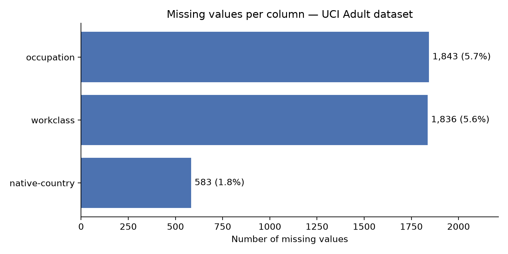
 
This graph is checking for which columns have missing values and how many. One bar column
that has a missing value. Bar length is the number of missing entries, labeled with the count
and percentage. Only 3 of the 15 columns have missing values, and all are categorical:
 
* Occupation        (1,843, 5.7%)
* Workclass         (1,836, 5.6%)
* Native-Country    (583, 1.8%)
The numeric columns are complete, so the cleaning job is filling missing categories
 
### Missingness Heatmap
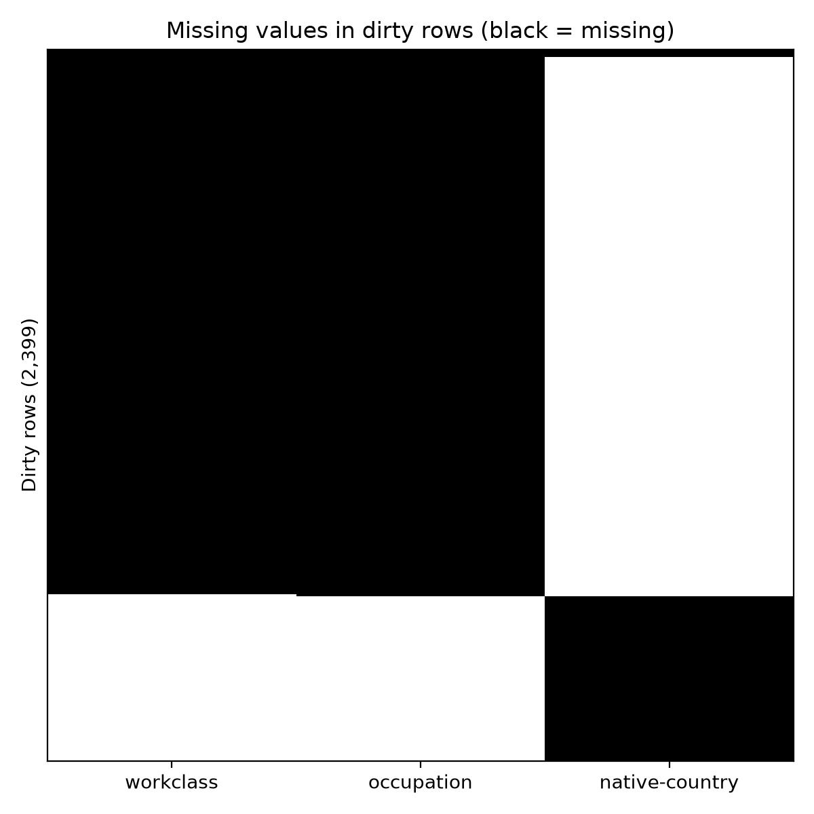
 
It checks for whether values go missing randomly or in patters. Each pixel row is 
one dirty record and each column is a feature. Black means missing.
Rows are sortedso matching patterns group into blocks. We found that the missing values
aren't random. Workclass and occupation go missing together, and native-country is 
missing on its own separate rows. So when someone's job info is gone, both job columns
are gone. Neither can helpfill the other.
 
### Capital Gains / Loss Box Plots
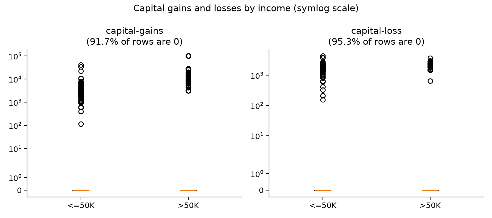
 
This graph looks for skew and outliers in the two money columns, split by income.
One panel per column, one box per income class. The box covers the middle
50% of values and dots are outliers. The y-axis uses a symlog scale so
zero and values in the tens of thousands fit on one chart. For our data this means
their is noise added due to the extreme skew. 91.7% of capital-gains and 
95.3% of capital-loss values are 0, so the boxes collapse to a line at 0.159 rows sit
at exactly 99,999 a cap in the data rather than real amounts. When people do have gains,
the >50K groups are much larger.
 
### Class Balance Histogram
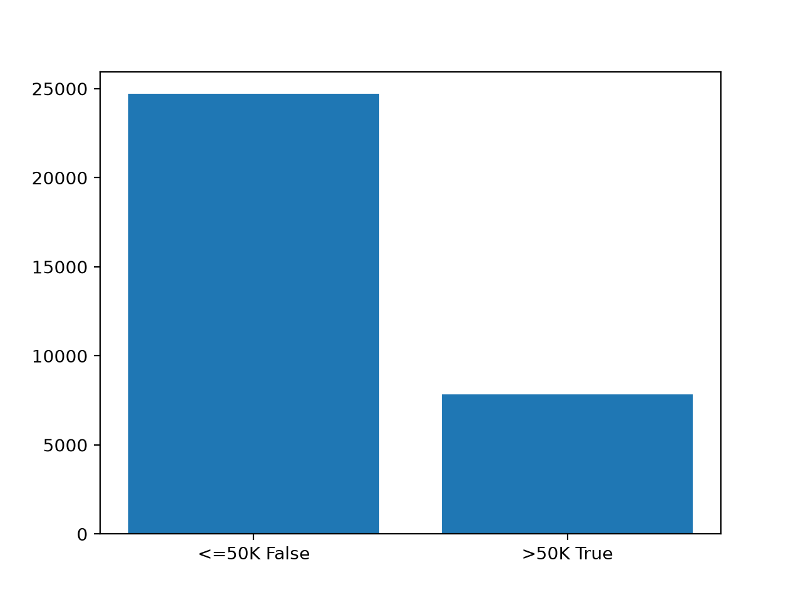
 
This graph looks to see how many people fall into each income class. It has two
bars one for >50K (True) and one for <=50K (False). Bar height is the number of
people. For our data this shows us the class imbalance, as their is a 3:1 ratio of 
<=50K to >50K. So a model who only guess <=50K would be correct accurate 75.9% of
the time.
 
### Information Gain Chart
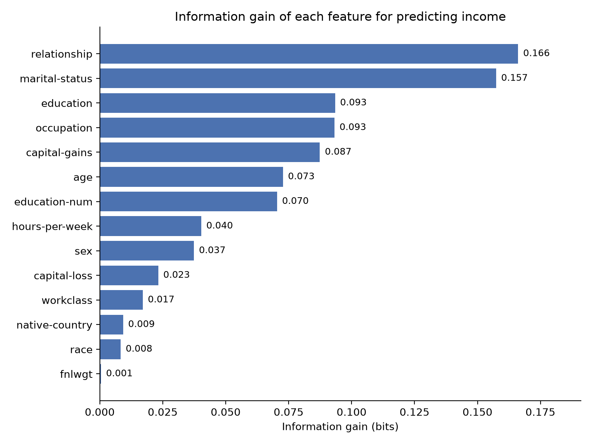
 
This chart shows how much each feature tells us about income. It has one bar
per feature, highest to lowest. Bar length is the information gain in bits,
starting with 0.81 for the entropy of income. The information we found showed
the strongest to be:
 
* Relationship (0.166)
* Marital-Status (0.157)
### Entropy Decision Tree
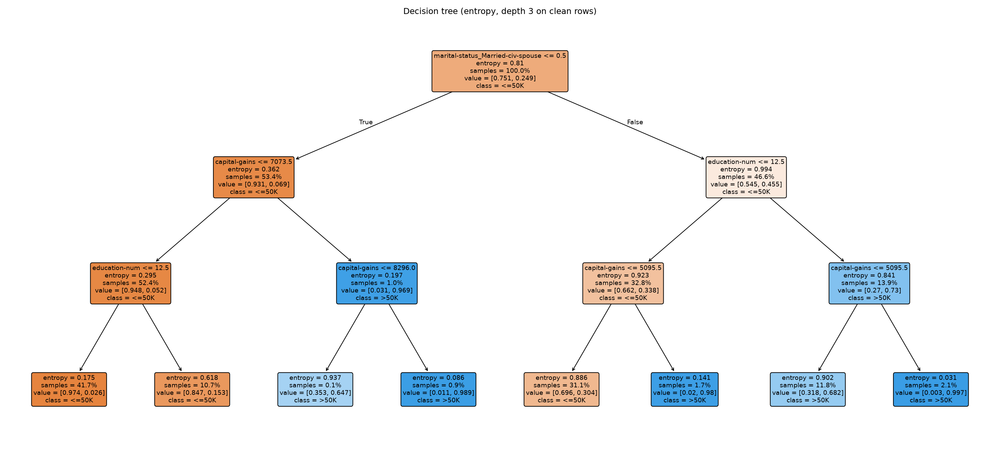
 
This tree shows how a decision tree would use these features, spliiting
on the highest-information-gained at each step. Every box is a node, the 
top line is split question (True goes left), entropy is how mixed the 
node still is. The graph shows that married vs not married is the 
first split. And Unmarried people are 93% <=50K unless their capital
gains are over ~7k. Married people are closer to 50/50 for income.
 
### Confusion Matrices
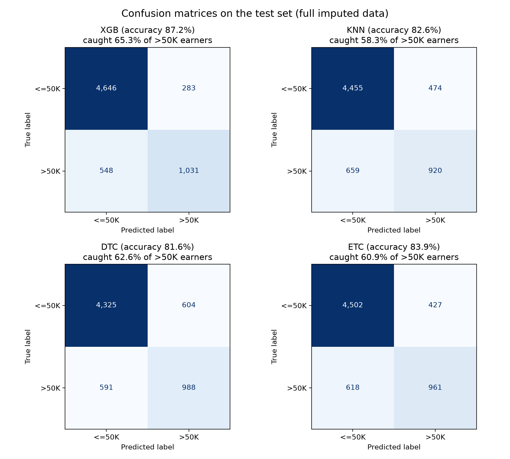
 
This graph checks what kinds of mistakes each model makes on the test set. There is
one 2x2 grid per model. Rows are the true income class and columns are what the model
predicted. Top-left is correct <=50K, top-right is false alarms, bottom-left is missed
high earners, and bottom-right is high earners correctly caught. Every model gets about
90% of the <=50K group right, but misses a lot of the high earners:
 
* XGB   (87.3% accuracy, caught 64.4% of >50K)
* ETC   (83.6% accuracy, caught 60.9% of >50K)
* KNN   (82.0% accuracy, caught 57.6% of >50K)
* DTC   (81.2% accuracy, caught 62.5% of >50K)
DTC has the most false alarms (635), which is a sign of overfitting since it has no
depth limit. Because of the class imbalance, accuracy makes the models look better
than they really are.
 
### ROC Curves
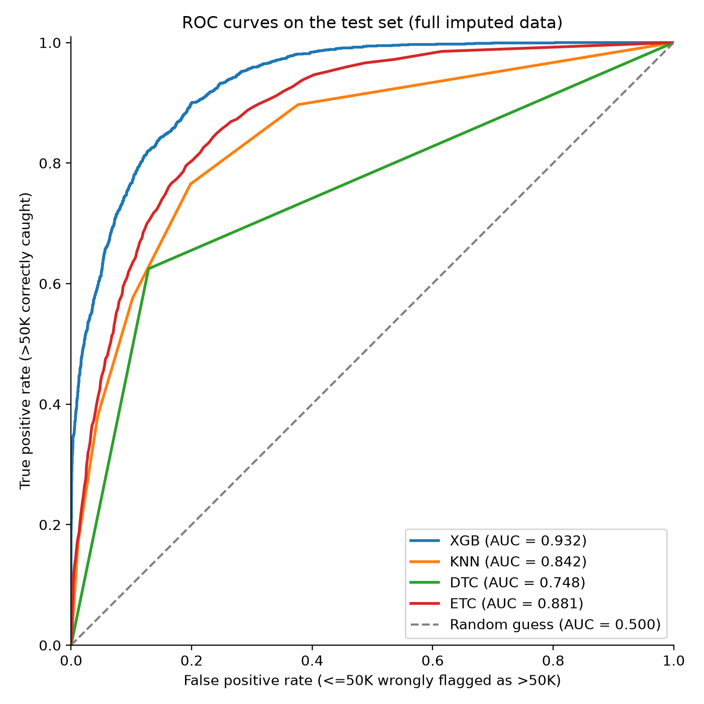
 
This graph checks how well each model ranks high earners above low earners at every
possible cutoff. There is one line per model. The y-axis is the share of >50K earners
caught and the x-axis is the share of <=50K people wrongly flagged as >50K. Closer to
the top-left is better, and the dashed diagonal is random guessing. AUC is in the
legend, where 1.0 is perfect and 0.5 is random. The results were:
 
* XGB   (0.932)
* ETC   (0.881)
* KNN   (0.842)
* DTC   (0.748)
XGB could catch about 90% of high earners while only flagging 20% of low earners just
by lowering its cutoff. DTC and KNN have straight-line segments because they only output
a few probability values (DTC only outputs 0 or 1).
 
### Precision-Recall Curves
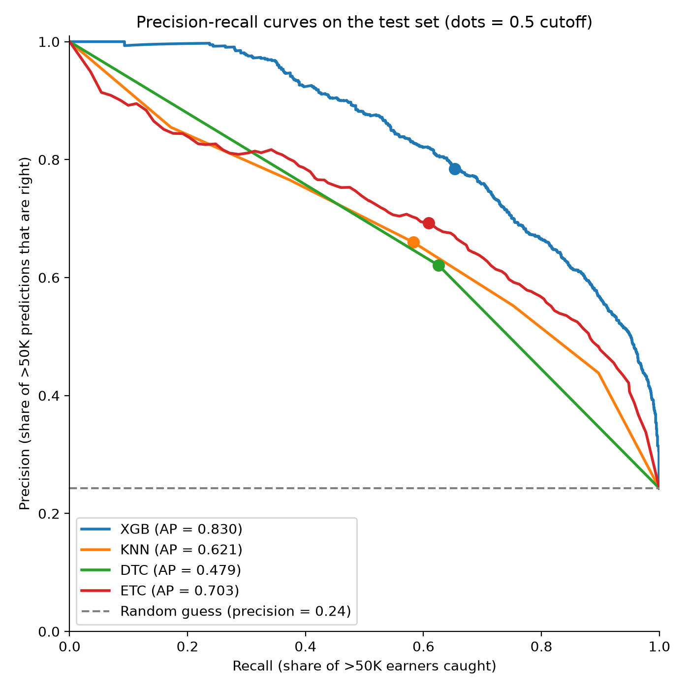
 
This graph checks the tradeoff between catching high earners and being right when the
model predicts one. Unlike ROC, it only looks at the >50K class, which makes it better
for imbalanced data. The x-axis is recall (share of high earners caught) and the y-axis
is precision (of the people predicted >50K, the share who really are). Top-right is best,
and the dashed line is random guessing at 0.24. The dots mark the default 0.5 cutoff,
which is where the confusion matrices were measured. AP is in the legend:
 
* XGB   (0.835)
* ETC   (0.691)
* KNN   (0.606)
* DTC   (0.470)
The ranking is the same as ROC but the gaps are much wider. DTC looked okay on ROC but
is not far above random guessing here. At the default cutoff, XGB is right about 79% of
the time when it predicts >50K, but it only catches 64% of the high earners.
 
### Clean vs Imputed Comparison
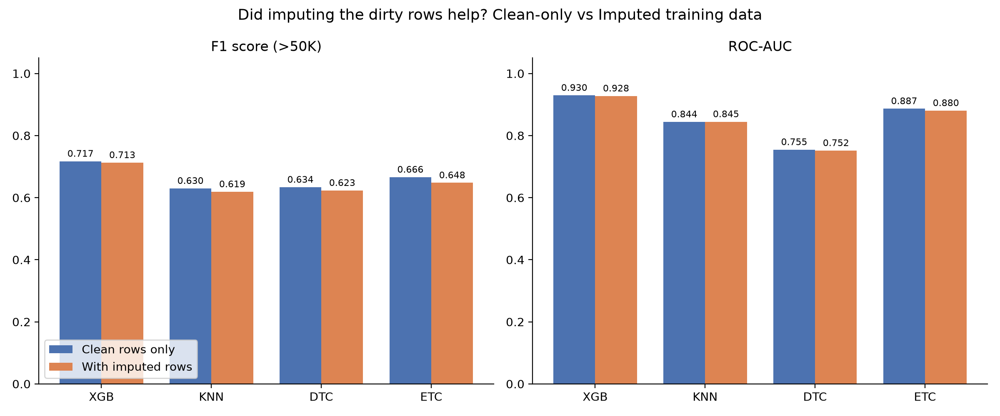
 
This graph checks if filling in the dirty rows helped the models compared to throwing
those rows away. There are two panels, F1 and ROC-AUC. Each model has a pair of bars,
blue is trained on clean rows only and orange includes the imputed rows. We found that
imputation barely changes performance either way. Every difference is under 0.02, and
F1 went down slightly for most models while AUC went up slightly. So the value of
imputation is coverage, not accuracy. It keeps 2,399 people (7.4%) in the data set
without hurting the models, so they can still make predictions for people with
incomplete records.
 
### K-Fold Box Plots
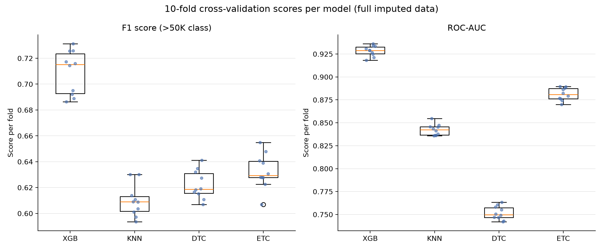
 
This graph checks how stable each model's score is across 10 different train/test
splits, and whether the differences between models are real or just luck. There are
two panels, F1 and ROC-AUC. Each box covers the middle 50% of a model's 10 fold scores,
the orange line is the median, and the dots are the individual folds. The y-axes are
zoomed in instead of starting at 0. XGB's win is real, its worst fold beats every
other model's best fold on both metrics:
 
* F1    (about 0.69 - 0.73)
* AUC   (about 0.92 - 0.94)
On AUC all four models are clearly separated, but on F1 ETC, DTC, and KNN overlap, so
their F1 ranking isn't reliable. F1 also changes by about 0.04 between folds, which is
more than the clean vs imputed differences, so imputation's effect is within normal noise.

